# AVAGalaga

[](https://github.com/Harlock123/AVAGalaga/actions/workflows/build.yml)

A shoot-'em-up in the style of Namco's 1981 arcade game **Galaga**, built with .NET 10 and Avalonia UI.
Waves of insect-like aliens swoop in along looping paths, settle into a formation that breathes in and
out, then peel off and dive at your fighter. The green commanders take two hits, and they can come down
low and catch your fighter in a tractor beam. Shoot down the commander that holds it while it dives, and
your captured fighter comes home to fly beside the one you have: a **dual fighter**, firing two shots at
once.

## Features

- **Forty enemies a stage** in five waves of eight, flying in on curving entry paths to their places in
  a ten-column formation: 4 **commanders**, 16 **moths** and 20 **drones**. While they arrive the
  formation sways; once they're all in, it breathes, spreading out and drawing in.
- **Dives**: enemies peel off in loops and come down at you, weaving and shooting. Drones loop on the way
  down from stage 2. A commander can take one or two moths from beneath it as escorts, and is worth up to
  **1,600** if you shoot its escorts first.
- **The tractor beam**: a commander stops low and lowers a shimmering beam. Get caught and your fighter is
  pulled up, spinning, to sit above it in the formation. Shoot that commander while it dives to win the
  fighter back as a **dual fighter**. Shoot it in the formation instead and your captured fighter turns on
  you (shoot it for 1,000).
- **Challenging stages** (stage 3, then every fourth stage): forty enemies loop through without firing
  and never land. Each hit scores 100, the tally is paid again as a bonus, and all forty earn a
  **10,000** special bonus.
- **Rising difficulty**: more divers at once, more shots, faster dives, and enemies that shoot as they fly
  in from stage 2.
- **Scrolling, twinkling starfield**, pixel-art sprites that turn to face the way they fly and flap their
  wings, explosions, and score pop-ups.
- **Stage flags** beside the playfield, counted the arcade way (flags for 50, 30, 20, 10, 5 and 1), and
  reserve fighters, with a bonus fighter at 20,000 and every 70,000 after.
- **Synthesised sound**, mixed by OpenAL: shots, hits, the dive whistle, the beam's warble, explosions,
  and short original tunes for each stage, the challenging stage, a perfect stage and the game over.
- **Attract mode**: leave the title alone for 15 seconds and a computer pilot plays a demonstration.
- **Top-ten high-score table** with arcade-style initials entry, and a hit-miss ratio at game over.
- **Keyboard, mouse or gamepad**. **Any window size**: the screen scales to fit, letterboxed.
  **Ctrl+S** saves a screenshot.
- **One self-contained executable** per platform: Windows, macOS and Linux on Intel/AMD and ARM.

## Screenshots

| Title screen | The first wave | The formation |
|:------------:|:--------------:|:-------------:|
| 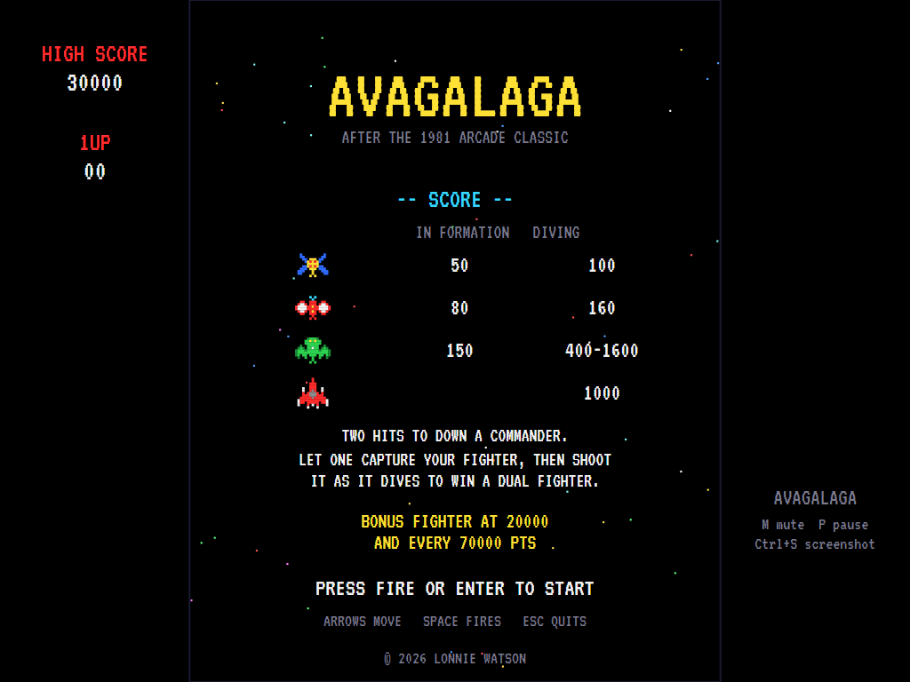 | 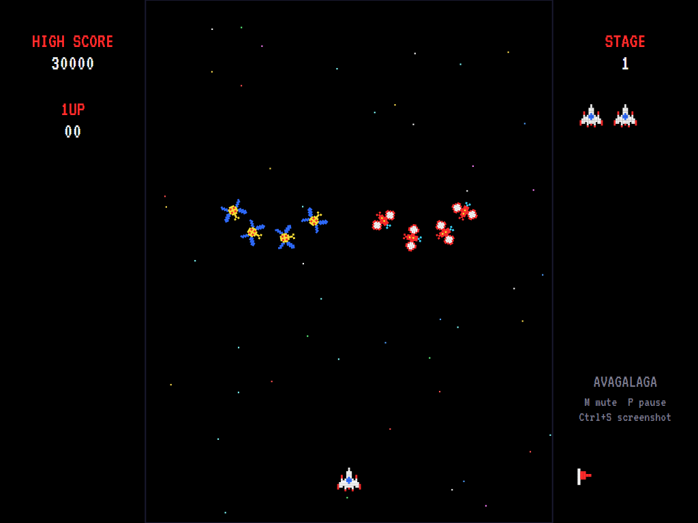 | 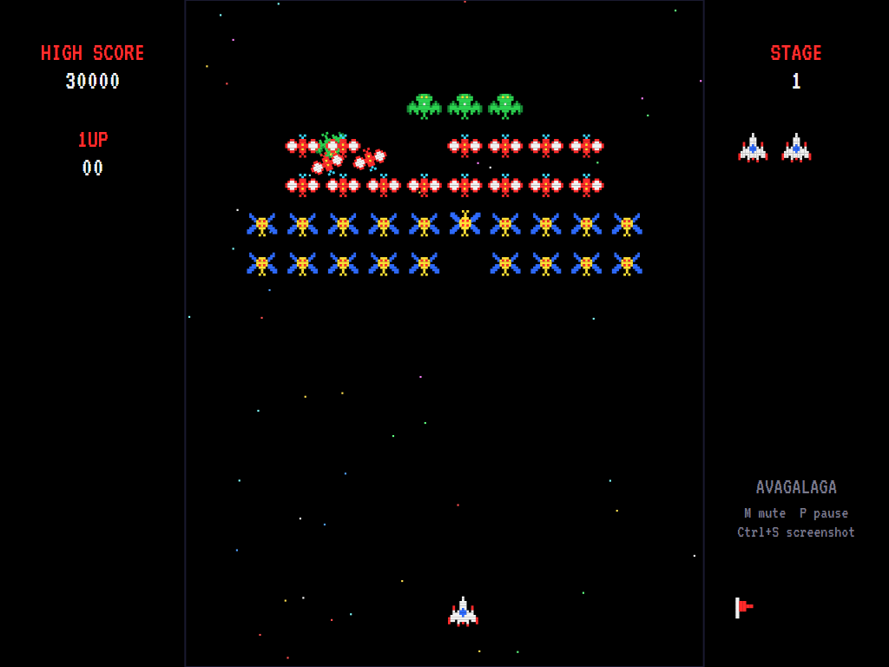 |
| What each enemy is worth, in the formation and diving. | Drones and moths loop in down the middle. | All forty in place; two peel off to dive. |

| The tractor beam | Fighter captured | Dual fighter |
|:----------------:|:----------------:|:------------:|
| 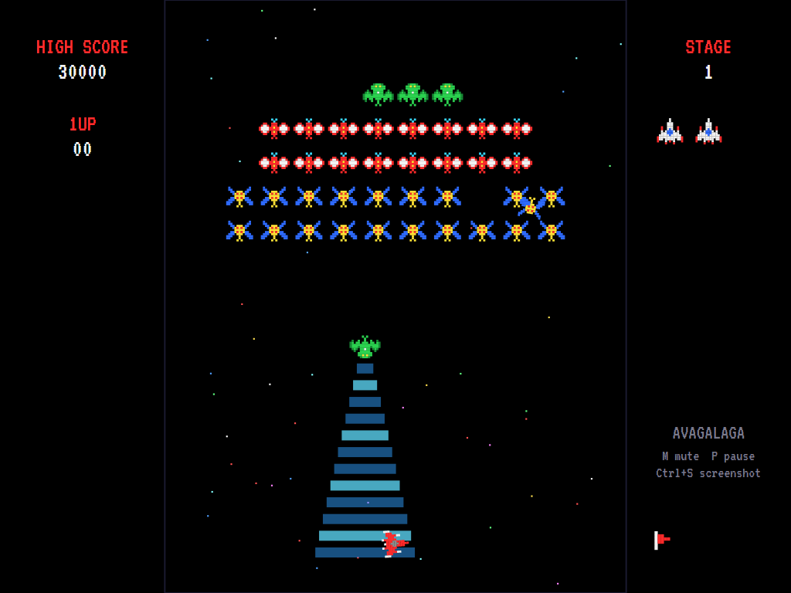 | 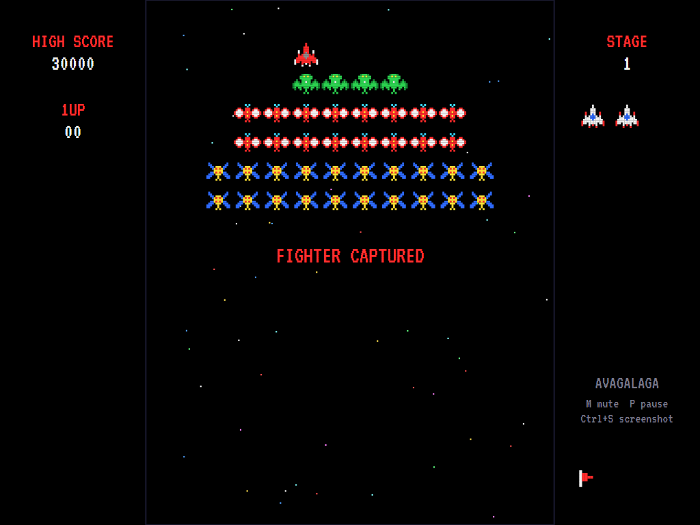 | 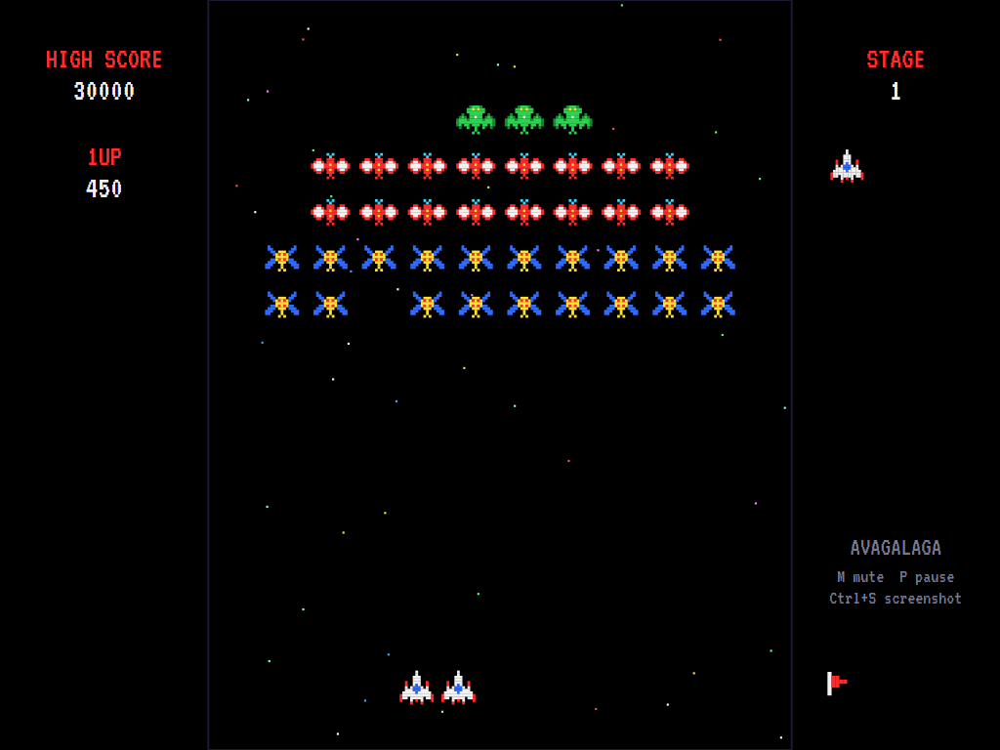 |
| A commander's beam pulls the fighter up. | The captive sits above the commander, in the formation. | Rescued: two fighters, two shots at a time. |

| Challenging stage | The tally | Game over |
|:-----------------:|:---------:|:---------:|
| 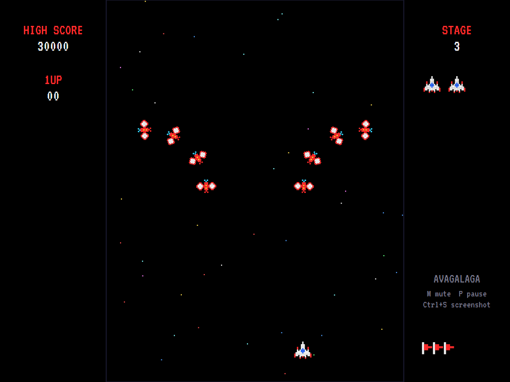 | 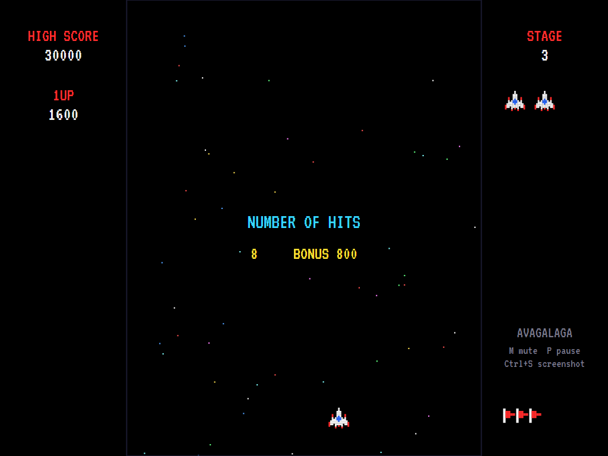 | 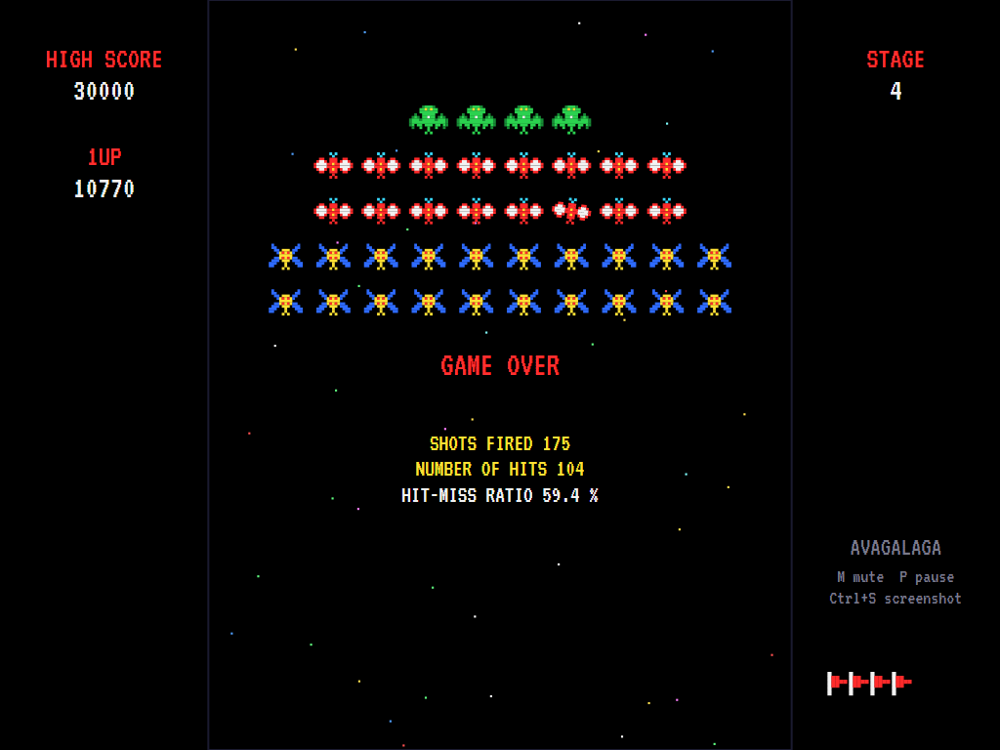 |
| Moths loop through without firing. | Hits and bonus after a challenging stage. | Shots fired, hits and the hit-miss ratio. |

| Entering initials | The high-score table |
|:-----------------:|:--------------------:|
| 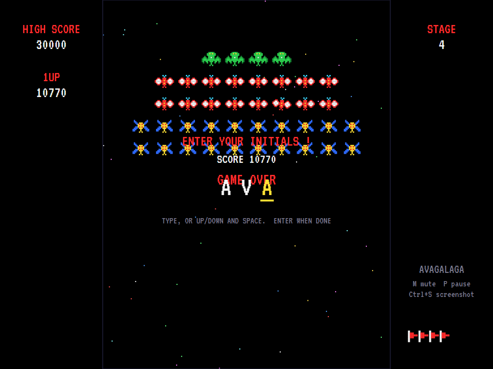 | 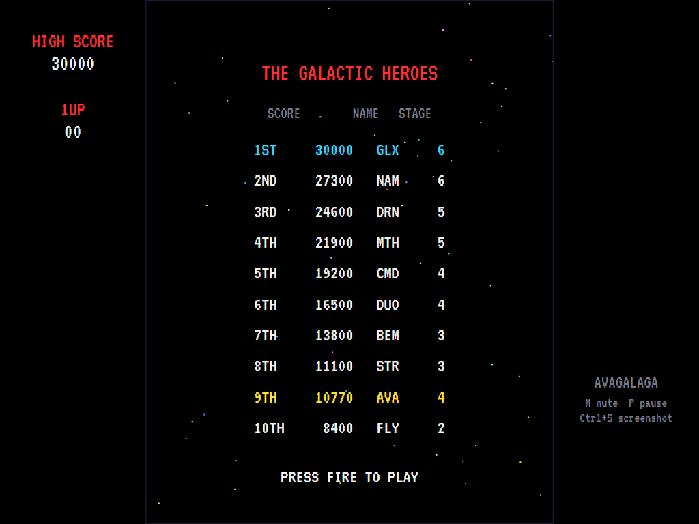 |
| A top-ten score earns three initials. | The new entry flashes in the table. |

The screenshots are made by the tests, which play the game in a real (headless) window; see
[Tests](#tests).

## Download and run

Ready-to-run builds for Windows, macOS and Linux, on both Intel/AMD and ARM, are on the
[Releases page](https://github.com/Harlock123/AVAGalaga/releases/tag/latest). **Latest build** is rebuilt
on every push to `main`. Each download is one self-contained executable: no .NET install is needed.

| Platform | Archive |
|---|---|
| Windows | `AVAGalaga-win-x64.zip`, `AVAGalaga-win-x86.zip`, `AVAGalaga-win-arm64.zip` |
| macOS | `AVAGalaga-osx-arm64.tar.gz` (Apple silicon), `AVAGalaga-osx-x64.tar.gz` (Intel) |
| Linux | `AVAGalaga-linux-x64.tar.gz`, `AVAGalaga-linux-arm64.tar.gz`, `AVAGalaga-linux-arm.tar.gz` |

```bash
tar -xzf AVAGalaga-linux-x64.tar.gz     # or linux-arm64, linux-arm, osx-arm64, osx-x64
./AVAGalaga
```

On Windows, unzip and run `AVAGalaga.exe`. On macOS, if Gatekeeper refuses to open it, run
`xattr -d com.apple.quarantine AVAGalaga` once. Run with `--no-audio` for silence.

**Sound** comes through OpenAL Soft, which is built in for every platform: nothing to install. In a
virtual machine the game detects it and uses a larger audio buffer, so the sound doesn't break up.

**Gamepads** use SDL2, which is bundled for Windows, macOS and Intel/AMD Linux. ARM Linux builds need it
installed; without it the keyboard and mouse still work:

```bash
sudo apt install libsdl2-dev            # Debian / Ubuntu / Raspberry Pi OS
sudo pacman -S --needed sdl2-compat     # Arch / Omarchy
```

## Controls

| Key | Action |
|-----|--------|
| **Left** / **Right**, **A** / **D** | Move |
| **Space**, **Ctrl**, **Up**, **W** | Fire (one shot per press; two in the air at most, four with a dual fighter) |
| **Enter** | Start a game |
| **P** / **Esc** | Pause (Esc again to quit) |
| **M** | Mute |
| **Ctrl+S** / **Cmd+S** | Save a screenshot to the Pictures folder |

**Mouse**: a click fires. **Gamepad** (Xbox/PlayStation/Switch Pro): D-pad or left stick to move, **A**,
**X**, **B** or the right trigger to fire, **Start** to start and pause, **Back** (while paused) to quit.

**Entering initials**: type letters, or dial with **Up**/**Down** and accept with **Space**; **Left** /
**Backspace** go back; **Enter** finishes. Gamepad: the D-pad dials and moves, **X** accepts, **Start**
finishes.

## Scoring

| Target | In the formation | Flying |
|--------|-----------------:|-------:|
| Drone (blue and yellow) | 50 | 100 |
| Moth (red and white) | 80 | 160 |
| Commander (green, two hits) | 150 | 400 |
| Commander, with one escort shot first | | 800 |
| Commander, with both escorts shot first | | 1,600 |
| Your captured fighter, turned enemy | | 1,000 |
| Any enemy in a challenging stage | | 100 |
| Challenging stage bonus | | 100 a hit; 10,000 for all 40 |

You start with three fighters (one in play and two in reserve), and win another at 20,000 points and
every 70,000 after.

## Tests

```bash
dotnet test AVAGalaga.slnx
```

The engine has no UI and runs in fixed 60 Hz steps, so it plays the same at any frame rate and a seed
always plays the same game. The tests check the formation, the scoring, the commanders' two hits, the
bonus fighters, firing rules, the capture-and-rescue that makes a dual fighter, the challenging stages,
the flight paths, the high-score table and the sound files. A computer pilot (the attract-mode one) plays
whole games in them.

The screenshot tests draw the real screen in a headless window. To refresh the README's pictures:

```bash
GALAGA_SHOTS=$PWD/Images dotnet test tests/AVAGalaga.Tests --filter ScreenshotTests
```

## Building

```bash
dotnet build AVAGalaga.slnx
dotnet run --project src/AVAGalaga
```

Needs the .NET 10 SDK. The sounds are made by `tools/make_sounds.py` (standard-library Python):
`python3 tools/make_sounds.py` rewrites `src/AVAGalaga/Sounds`.

## Project structure

```
AVAGalaga/
├── AVAGalaga.slnx
├── src/AVAGalaga/
│   ├── Engine/
│   │   ├── GameEngine.cs          # States, scoring, bonus fighters, stars, the title/demo/high-score cycle
│   │   ├── GameEngine.Stage.cs    # Stages, waves, challenging stages
│   │   ├── GameEngine.Enemies.cs  # Flying in, the formation, dives, escorts, the tractor beam, capture, rescue
│   │   ├── GameEngine.Player.cs   # The fighter, its shots, collisions and points
│   │   ├── Formation.cs, Paths.cs # The formation's places; the entry and challenge flight paths
│   │   ├── AttractPilot.cs        # The computer pilot for the demonstration (and the tests)
│   │   ├── HighScoreTable.cs, InitialsEntry.cs
│   │   ├── InputHandler.cs, ControllerManager.cs  # Keyboard, mouse and SDL2 gamepads
│   │   └── SoundManager.cs        # Effects and tunes through OpenAL
│   ├── Audio/                     # The OpenAL engine (from the author's AVABand)
│   ├── Models/                    # The playfield, and the pixel-art sprites
│   ├── Views/                     # The screen: playfield, panels, title, tables
│   └── Sounds/                    # The synthesised effects and tunes
├── tests/AVAGalaga.Tests/         # Gameplay, paths, and screenshot tests
├── tools/make_sounds.py, tools/plot_paths.sh
└── Images/                        # Screenshots
```

## About and licence

AVAGalaga © 2026 Lonnie Watson, under the [MIT License](LICENSE).

*Galaga* © 1981 Namco (now Bandai Namco), which owns the name. AVAGalaga is an independent, unofficial
game in its style. Its sprites, sounds, tunes and code are its own; nothing is taken from the arcade
machine's program, graphics or sound. It is not affiliated with or endorsed by Bandai Namco.

Bundled components keep their own licences: the VT323 font (SIL Open Font License 1.1, by Peter Hull;
`src/AVAGalaga/Assets/Fonts/VT323-OFL.txt`), OpenAL Soft (LGPL-2.0-or-later; loaded as a separate
library; `src/AVAGalaga/Audio/native/COPYING-openal-soft.txt`), and the MIT-licensed Avalonia, Silk.NET,
NVorbis, NLayer and SDL2-CS (with SDL2 under the zlib licence).
